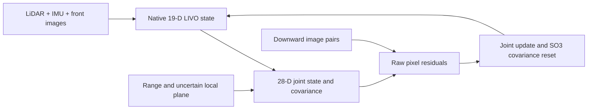

# IMPACT

[中文](README.md) · [Reference results](docs/REFERENCE_RESULTS.md) · [Troubleshooting](docs/TROUBLESHOOTING.md) · [Component licenses](THIRD_PARTY_NOTICES.md)

Research software for navigation without GNSS. The current fusion method extends the native 19-dimensional FAST-LIVO2 state with a six-dimensional pose clone and a three-dimensional uncertain local plane. It updates the same native state and covariance using raw two-view downward-image pixels, while retaining the declared shared inertial and plane correlations.

The motivation is that rotation compensation and range-derived scale share uncertain quantities with the estimator. Treating their derived measurements as independent can count that information more than once. This repository provides the joint model, two cross-covariance ablations, and independent mathematical checks. It does not establish a universal accuracy or integrity guarantee.



A separate historical pipeline implements FAST-LIO, map-based directional information, empirical protection levels, candidate planning, dynamic obstacles and latency handling. It has not been integrated and validated with the new joint estimator in an AP closed-loop mission.

## Choose a reproduction path

| Goal | Dependencies/data | Main entry | Success artifact |
|---|---|---|---|
| Six independent mathematical/core studies | CPU, Python 3.10, g++, Eigen, NumPy, Matplotlib; no ROS or recording | `server/offline_studies.py` | `summary.json`, all six studies PASS |
| Five-method recorded sensor replay | ROS 2 Humble, C++ dependencies, released recording and pinned sources; no running Gazebo or GPU | `server/build_livo_server.sh`, `run_livo_server.sh` | Suite PASS, complete input tails, independent evaluation PASS |
| Historical Gazebo scenarios | Gazebo Harmonic, 14-package base build, EGL rendering | `server/run_headless_sim.py`, `run_scenario.py` | Each run's `result.json`; SMOKE and MISSION are different |
| AP 4.7.1 interface preparation | Pinned AP source, build dependencies and private venv | `server/ap471_server.py` | Preparation/UNARMED smoke results; no flight conclusion |

The supported server target is **Ubuntu 22.04 / x86_64**. Orin NX is an intended ARM hardware target; this server validation does not establish its performance. Hardware plans use Livox Mid-360 and CUAV X25 MEGA; the specific front camera and MicoAir flow module are still unspecified.

## Start without ROS or a large download

```bash
git clone https://github.com/Accelerate11/IMPACT.git
cd IMPACT
export IMPACT_ROOT="$PWD"
export IMPACT_RUN_ROOT="$(dirname "$PWD")/impact-runs"
mkdir -p "$IMPACT_RUN_ROOT"

# Only the CPU-study dependencies; sudo/network are needed for first installation.
bash server/install_dependencies.sh --install --profile offline
bash server/install_dependencies.sh --check --profile offline

OFFLINE_OUT="$IMPACT_RUN_ROOT/offline_$(date -u +%Y%m%dT%H%M%SZ)"
/usr/bin/python3 server/offline_studies.py --root "$IMPACT_ROOT" --output "$OFFLINE_OUT"
```

Read `$OFFLINE_OUT/summary.json`. It must report `status: PASS`, with six entries named `shared_scale`, `correlated_flow`, `two_view`, `joint_window`, `joint_core` and `serial_core`, each PASS. Two studies compile C++ programs, so allow several minutes depending on CPU. Results/logs are retained on failure or interruption; use a new output directory for a new attempt.

These synthetic/core studies do not replay the recorded flight. The serial baseline is a standalone prototype, not a sixth method in the native replay experiment.

## Reproduce the five-method recorded experiment

Continue in the same repository, using system Python 3.10. Install dependencies before any bound experiment: the build manifests bind the installed dpkg package versions.

```bash
bash server/install_dependencies.sh --install --profile full
bash server/install_dependencies.sh --check --profile full
/usr/bin/python3 server/fetch_resources.py --root "$IMPACT_ROOT"
/usr/bin/python3 server/independent_verify_bundle.py --workspace "$IMPACT_ROOT" \
  --output "$IMPACT_RUN_ROOT/coverage_$(date -u +%Y%m%dT%H%M%SZ).json"

bash server/build_livo_server.sh --root "$IMPACT_ROOT" \
  --runtime-root "$IMPACT_RUN_ROOT/livo" --jobs 1
bash server/run_livo_server.sh prepare --root "$IMPACT_ROOT" \
  --runtime-root "$IMPACT_RUN_ROOT/livo"
TRIAL="$IMPACT_RUN_ROOT/five_modes_$(date -u +%Y%m%dT%H%M%SZ)"
bash server/run_livo_server.sh replay --root "$IMPACT_ROOT" \
  --runtime-root "$IMPACT_RUN_ROOT/livo" --output "$TRIAL"
bash server/run_livo_server.sh evaluate --root "$IMPACT_ROOT" \
  --runtime-root "$IMPACT_RUN_ROOT/livo" --run "$TRIAL" --output "${TRIAL}_evaluation"
```

Use a new `livo` runtime path for each rebuild; `prepare`, replay and evaluation must refer to that same build. Existing outputs are never reused as new evidence. Reserve at least 20 GiB disk and 8 GiB RAM for the complete workflow; one build job is recommended. These are capacity recommendations, not a timing guarantee.

Resources come from the immutable [server resource release](https://github.com/Accelerate11/IMPACT/releases/tag/server-sim-2026.10.22). The downloader verifies 18 parts, the assembled archive, its authenticated manifest and all 25,503 entries. The compressed resource is 1,188,223,315 bytes; regular extracted files total 2,943,013,858 bytes. A source ZIP or a Git clone alone does not contain these resources. No main-repository `git submodule update` is needed to install them.

The B1 bag has six SQLite partitions plus metadata (1,503,077,896 bytes). It contains **24,144 sensor messages**: 16,586 IMU, 830 LiDAR, 1,270 front images, 1,270 downward images and 4,188 range messages. Keep all partitions. The wrapper regenerates local indexes from read-only SQLite; never reuse historical absolute-path indexes by editing their hashes. Truth is exported separately and used only after the estimator exits.

| Method | Meaning | Reference ATE RMS (mm) | Actual flow updates |
|---|---|---:|---:|
| `native` | Native LIVO; no auxiliary joint state | 7.368785 | 0 |
| `joint_no_flow` | Joint/clone/plane machinery, pixel update disabled | 7.203131 | 0 |
| `full` | Full declared joint correlation model | 6.644720 | 37 |
| `zero_gyro` | Remove gyro-tagged cross blocks; retain IMU propagation | 6.768476 | 37 |
| `zero_plane` | Remove plane-to-other-state cross covariance; retain marginals | 6.742032 | 37 |

These values describe **one recorded simulated flight**, not repeated flights or statistical superiority. Alignment uses the first matched SE(3) pair without fitting scale. The reference report has 1,253 matches and no unmatched states. See [metric definitions, expected files and checked-in evidence](docs/REFERENCE_RESULTS.md). Numerical variation should be investigated rather than hidden behind arbitrary acceptance tolerances.

## Gazebo and AP

```bash
bash server/build_workspace.sh --root "$IMPACT_ROOT" \
  --runtime-root "$IMPACT_RUN_ROOT/base" --jobs 1
/usr/bin/python3 server/run_headless_sim.py --root "$IMPACT_ROOT" \
  --runtime-root "$IMPACT_RUN_ROOT/base" --duration 30 --renderer software
/usr/bin/python3 server/run_scenario.py --root "$IMPACT_ROOT" \
  --runtime-root "$IMPACT_RUN_ROOT/base" --scenario p15_lattice \
  --variant integrity_constrained --seed 501 --duration 30 --renderer software
```

Headless GPU LiDAR/cameras still need EGL; software rendering verifies function, not real-time performance. The base scene uses historical 2-D proxies. The advanced scenario runs native FAST-LIO and historical planning with a velocity-controlled carrier. Neither connects the new joint estimator to AP. `--require-mission-complete` explicitly requests the stronger mission gate; a short SMOKE PASS does not pass it. See [simulation](server/SIMULATION_RUNBOOK.md) and [scenarios](server/SIMULATION_SCENARIOS.md).

AP commands use official Copter 4.7.1 commit `dbe792162d06cab66c3475fd5556bf7a120f119e`:

```bash
/usr/bin/python3 server/ap471_server.py --root "$IMPACT_ROOT" audit
/usr/bin/python3 server/ap471_server.py --root "$IMPACT_ROOT" \
  --workspace "$IMPACT_RUN_ROOT/ap471" prepare --jobs 2
# Replace PREPARATION_RUN with the emitted preparation result's "run" path.
PREPARATION_RUN=/absolute/path/to/ap471_prepare_run
/usr/bin/python3 server/ap471_server.py --root "$IMPACT_ROOT" \
  --workspace "$IMPACT_RUN_ROOT/ap471" smoke \
  --preparation "$PREPARATION_RUN" --base-port 18070 --instance 37
```

These wrappers have no ARM/flight subcommand. Version/parameter smoke is not evidence of EKF fusion or task completion. See [AP instructions](server/AP471_RUNBOOK.md).

## Versions, papers and limitations

The fixed paper reference is tag `server-sim-2026.10.22`, commit `5750e6e204b697349e7b08bc1aca5e0bee1d51a9`. That tag retains the original instructions and metadata. Current `main` adds the offline installation profile, clearer documentation and license/provenance corrections. Select the old tag only when reproducing the original snapshot exactly; commands added later are not available there. Record `git rev-parse HEAD` with your own results.

- [English/Chinese PDFs and editable LaTeX](papers/README.md); author information remains pending. These are drafts, without a publication-acceptance claim.
- [Formula-to-implementation map](server/ALGORITHM_COVERAGE.md) and [machine-readable source identities](server/coverage_manifest.json).
- [Citation](CITATION.md), [license/source index](THIRD_PARTY_NOTICES.md), [hardware demo plan](docs/HARDWARE_DEMO_PLAN.md), and [known reproduction issues](docs/TROUBLESHOOTING.md).

Prior validation was performed in fresh WSL Ubuntu 22.04/x86_64 paths, not on your server or physical vehicle. The recorded experiment uses simulation calibration constants and exact timestamp associations. Real camera calibration parameterization, asynchronous hardware associations, Orin timing, multi-scene degradation statistics, integrity calibration and a new-estimator/AP complete closed loop remain separate work. The current ROS integration requires raw downward images; it has no external feature-track adapter, and module velocity alone cannot replace that input.

When reporting a problem, open a [GitHub issue](https://github.com/Accelerate11/IMPACT/issues) with commit, OS/architecture, exact command, result status and relevant bounded logs. Keep failed directories. Stop active experiments before `git pull --ff-only`; source changes require a fresh build/runtime, not edited manifests.
