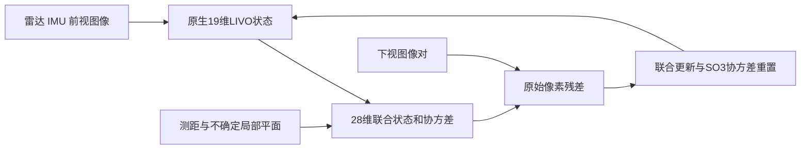

# IMPACT

[English](README.en.md) · [参考结果与验收](docs/REFERENCE_RESULTS.md) · [复现排错](docs/TROUBLESHOOTING.md) · [公开复现检查](docs/OPEN_SOURCE_AUDIT_20261026.md) · [组件许可与来源](THIRD_PARTY_NOTICES.md)

面向 GNSS 拒止无人机导航的多源融合、完好性裕度规划与主动控制研究代码。

当前服务器目标为 **Ubuntu 22.04 / x86_64 / ROS 2 Humble / Gazebo Harmonic**，飞控固件固定为官方 **ArduCopter 4.7.1**。计划中的实机为 Livox Mid-360、相机、微空下视光流、NVIDIA Orin NX 与 CUAV X25 MEGA；相机及微空模块的具体型号仍待确定。

本仓库同时保留两条研究线：

- **新多源融合**：在 FAST-LIVO2 原生 19 维状态上加入位姿克隆和不确定局部平面，以 28 维联合状态融合原始两视图像素；包含原生、联合无光流、完整模型及两项相关性消融。
- **历史规划与执行**：FAST-LIO、方向信息与经验保护水平、AL−PL 硬约束、候选规划、动态地图、时延控制及故障响应。新融合与历史规划尚未完成联合闭环验证。

当前硬件与验证范围以本页和 `server/` 运行手册为准。旧平台、P0–P15 和复杂场景记录完整保留于 [历史 README](docs/README_LEGACY_P0_P15.md)、`docs/` 与 `evidence/`；旧结果的条件和固件版本保持原样。

## 核心方法在解决什么

下视图像的旋转补偿、测距尺度与已有状态会共享不确定量。如果把由它们得到的观测直接当成独立信息，可能重复计算信息。本方法把原生19维状态、6维位姿克隆和3维局部平面放入同一28维协方差，以原始两视图像素残差更新原生状态，并保留声明模型下的相关项。五组回放用于检验实际更新及两项相关性消融，不预设所有条件下完整模型都更优。



## 选择复现路径

| 目的 | 所需环境与数据 | 入口 | 成功依据 |
|---|---|---|---|
| 理解数学机制，运行六项独立研究 | CPU、Python3.10、g++、Eigen、NumPy、Matplotlib；不需要ROS、Gazebo或原始bag | `offline_studies.py` | `summary.json`及六组状态均PASS |
| 复现论文五方法 | ROS2 Humble、C++依赖、发布的记录和固定源码；不启动Gazebo，不需要GPU | LIVO build/prepare/replay/evaluate | 完整输入尾部、套件和独立评估通过 |
| 历史Gazebo/复杂场景 | 基础14包、Harmonic、EGL渲染 | headless/scenario入口 | 每次run的result，区分SMOKE与MISSION |
| AP4.7.1接口 | 固定AP源码、编译依赖、私有venv | `ap471_server.py` | 准备/未解锁smoke；不等于飞行通过 |

## 最短体验：不用先装ROS或下载大数据

```bash
git clone https://github.com/Accelerate11/IMPACT.git
cd IMPACT
export IMPACT_ROOT="$PWD"
export IMPACT_RUN_ROOT="$(dirname "$PWD")/impact-runs"
mkdir -p "$IMPACT_RUN_ROOT"

bash server/install_dependencies.sh --install --profile offline
bash server/install_dependencies.sh --check --profile offline
OFFLINE_OUT="$IMPACT_RUN_ROOT/offline_$(date -u +%Y%m%dT%H%M%SZ)"
/usr/bin/python3 server/offline_studies.py --root "$IMPACT_ROOT" --output "$OFFLINE_OUT"
```

首次安装需要sudo和网络。打开 `$OFFLINE_OUT/summary.json`：总状态及 `shared_scale`、`correlated_flow`、`two_view`、`joint_window`、`joint_core`、`serial_core` 六项都应为PASS。含两个C++编译步骤，耗时取决于CPU；这条路径不回放论文记录，也不把串联原型变成第六个真实回放方法。

失败、中断及各组日志会保留；重试使用新输出目录。完整依赖安装仍兼容原来的 `--install`，也可显式用 `--profile full`。

## 完整服务器环境与资源

以下从已有项目根目录执行。若直接选择完整复现，先执行上方的clone和变量设置，无需先运行离线研究。

```bash
export IMPACT_ROOT="$PWD"
export IMPACT_RUN_ROOT="$(dirname "$PWD")/impact-runs"
mkdir -p "$IMPACT_RUN_ROOT"

# 首次安装系统依赖；需要 sudo 和网络。
bash server/install_dependencies.sh --install --profile full
bash server/install_dependencies.sh --check --profile full

# 下载固定资源，逐文件核对；约 1.19 GB 压缩包，解压约 2.94 GB。
python3 server/fetch_resources.py --root "$IMPACT_ROOT"
python3 server/independent_verify_bundle.py --workspace "$IMPACT_ROOT" \
  --output "$IMPACT_RUN_ROOT/bundle-coverage.json"
```

运行前先 `mkdir -p "$IMPACT_RUN_ROOT"`。验证输出必须使用新文件名；脚本不会覆盖原失败或先前结果。

Git 保存源码、参数、测试、服务器入口、论文与轻量验证记录。完整原始仿真数据和第三方源树由 [GitHub Release](https://github.com/Accelerate11/IMPACT/releases/tag/server-sim-2026.10.22) 提供，SHA-256 固定在 [server/resources.json](server/resources.json)。普通 `git clone` 不需要先下载这些大文件。

已经手动上传资源包时可以离线安装：

```bash
python3 server/fetch_resources.py --root "$IMPACT_ROOT" \
  --archive /path/to/IMPACT_Server_Resources_20261022_v2.tar.gz
```

资源目录保持只读；若要手动检查其中的 Git 状态，使用 `GIT_OPTIONAL_LOCKS=0 git -C third_party/ardupilot status`，避免 Git 刷新受清单保护的 index。构建工具会复制到独立运行目录。

这不会离线提供 Ubuntu/ROS 系统软件包。AP 构建所用 Python 依赖装入运行目录内的私有 venv；系统依赖与这些首次安装步骤仍可能需要网络。

建议预留 **20 GiB 以上磁盘**，使用单编译线程；8 GiB 内存可运行已验证的单任务构建，16 GiB 更方便。五组 LIVO 回放使用 CPU，不要求 GPU。Gazebo 相机和 GPU LiDAR 即使无窗口也需要可用 EGL 渲染后端，可先用软件渲染验证功能。

## 1. 先运行独立算法研究

使用上方“最短体验”命令即可；已运行过的不必重复。六项依次检查共享尺度、共享误差相关性、两视图几何、跨窗联合状态、28维C++核心和串联原型。每项有独立日志与结果；它们不代替真实状态回放或完整飞行实验。

## 2. 复现论文中的五组联合融合实验

```bash
bash server/build_livo_server.sh --root "$IMPACT_ROOT" \
  --runtime-root "$IMPACT_RUN_ROOT/livo" --jobs 1

bash server/run_livo_server.sh prepare --root "$IMPACT_ROOT" \
  --runtime-root "$IMPACT_RUN_ROOT/livo"

TRIAL="$IMPACT_RUN_ROOT/joint_five_$(date -u +%Y%m%dT%H%M%SZ)"
bash server/run_livo_server.sh replay --root "$IMPACT_ROOT" \
  --runtime-root "$IMPACT_RUN_ROOT/livo" --output "$TRIAL"

bash server/run_livo_server.sh evaluate --root "$IMPACT_ROOT" \
  --runtime-root "$IMPACT_RUN_ROOT/livo" \
  --run "$TRIAL" --output "${TRIAL}_evaluation"
```

五组分别为 `native`、`joint_no_flow`、`full`、`zero_gyro`、`zero_plane`。完整记录包含 6 个 SQLite 分卷及元数据，必须全部保留。新服务器会重新生成本机索引，原始采集戳与载荷不变；真值只用于估计进程结束后的独立评估。

| 方法 | 含义 | 参考ATE RMS / mm | 实际光流状态/协方差更新 |
|---|---|---:|---:|
| `native` | 原生LIVO，无附加联合状态 | 7.368785 | 0 |
| `joint_no_flow` | 保留联合/克隆/平面机制，禁用像素更新 | 7.203131 | 0 |
| `full` | 完整声明相关模型 | 6.644720 | 37 |
| `zero_gyro` | 去陀螺标记交叉块，仍使用IMU传播 | 6.768476 | 37 |
| `zero_plane` | 去平面与其余状态交叉协方差，保留边际 | 6.742032 | 37 |

误差为首对SE(3)对齐、无尺度拟合后的位置误差；按采集戳与15ms内最近真值匹配。本次1253个匹配、0未匹配，最大时间差9ms。完整字段、结果文件位置及验收说明见[参考结果](docs/REFERENCE_RESULTS.md)。

检查 `suite-result.json`、各组的 `run-result.json` 和评估 `report.json`，同时核对所有输入尾部、状态实际更新与独立数值重建。终端出现里程计消息并不等于处理完成。详见 [LIVO 运行手册](server/LIVO_RUNBOOK.md)。

参考输入是一段仿真飞行，完整模型产生 37 次真实原生状态/协方差更新；联合无光流与完整模型的参考位置 RMS 分别为 7.203 mm 和 6.645 mm。这些结果来自同一条轨迹，尚不构成多场景统计优越性或经校准的完好性界。

## 3. 无界面 Gazebo 与复杂场景

先构建 14 个基础 ROS 包；LIVO 使用上一节的独立构建：

```bash
bash server/build_workspace.sh --root "$IMPACT_ROOT" \
  --runtime-root "$IMPACT_RUN_ROOT/base" --jobs 1

python3 server/run_headless_sim.py --root "$IMPACT_ROOT" \
  --runtime-root "$IMPACT_RUN_ROOT/base" --duration 30 --renderer software
```

基础 smoke 运行 LiDAR/IMU 与历史算法代理。复杂场景入口调用原生 FAST-LIO 和历史完好性/动态地图/时延链，提供仓库、三维、双向、组合障碍与 P15 候选格点等配置：

```bash
python3 server/run_scenario.py --root "$IMPACT_ROOT" \
  --runtime-root "$IMPACT_RUN_ROOT/base" \
  --scenario p15_lattice --variant integrity_constrained \
  --seed 501 --duration 60 --renderer software

# 配对比较：保持场景与 Gazebo seed 相同，只改变已声明的策略。
python3 server/run_scenario.py --root "$IMPACT_ROOT" \
  --runtime-root "$IMPACT_RUN_ROOT/base" \
  --scenario p15_lattice --variant information_only \
  --seed 501 --duration 60 --renderer software
```

本次新路径已通过 `p15_lattice`、seed 501 的30秒 `SMOKE`，观测到 LiDAR、IMU、原生 FAST-LIO、完好性、地图和规划决策；完整任务仍未通过，详见 `server/advanced_simulation_validation.json`。其他场景需要分别运行验收。

短时间 `SMOKE` 只检验接入、传感器和指定算法节点运行；需要完整任务验收时显式使用 `--require-mission-complete` 和足够的运行时长，并以原任务评估器结果为准。Gazebo seed 会真实传入，但原桥的条件化种子等随机源另有固定定义，因此不要把它标成所有随机源均独立的多种子统计。

场景参数、故障注入和批量运行说明见 [场景手册](server/SIMULATION_SCENARIOS.md)；基础构建与观测范围见 [仿真运行手册](server/SIMULATION_RUNBOOK.md)。这些无 AP 场景使用速度控制载体，未连接新 28 维联合滤波器，不能写成新融合驱动的 AP 闭环飞行。

## 4. AP 4.7.1

```bash
python3 server/ap471_server.py --root "$IMPACT_ROOT" audit
python3 server/ap471_server.py --root "$IMPACT_ROOT" \
  --workspace "$IMPACT_RUN_ROOT/ap471" prepare --jobs 2
```

准备结果中的 `run` 作为 `--preparation` 传入未解锁检查：

```bash
python3 server/ap471_server.py --root "$IMPACT_ROOT" \
  --workspace "$IMPACT_RUN_ROOT/ap471" smoke \
  --preparation /absolute/path/to/ap471_prepare_run --base-port 18070 --instance 37
```

固定源码提交为 `dbe792162d06cab66c3475fd5556bf7a120f119e`。包内含独立 Git 与完整递归子模块，不依赖原机器的 worktree `.git` 指针。包装器默认没有 ARM/飞行子命令；无解锁版本和参数检查不代表 EKF 已融合或飞行任务通过。MAVROS、插件构建及显式端口说明见 [AP 运行手册](server/AP471_RUNBOOK.md)。

## 目录与论文

```text
src/                     15 个 ROS 包，含 LIO/LIVO、规划与故障算法
scripts/                 原研究、审计、回放与历史任务入口
config/                  固定协议、噪声、场景与门限
server/                  可移植服务器入口、运行手册和验证记录
prototypes/serial_position/ 独立串联原型（未接入五组真实回放）
papers/                  中英文论文、完整推导、图表及 LaTeX
docs/                    研究与历史实验说明
data/ third_party/       Release 下载资源，Git 忽略
```

完整公式到代码映射见 [算法覆盖表](server/ALGORITHM_COVERAGE.md)。软件范围、已完成与待完成的验收见 [软件验收矩阵](docs/SOFTWARE_COMPLETION_ACCEPTANCE.md) 和 [阶段记录](docs/SOFTWARE_COMPLETION_LOG.md)。

装机演示建议与采集要求见 [实机 Demo 计划](docs/HARDWARE_DEMO_PLAN.md)。当前ROS接入需要原始下视图像，尚无外部像素轨迹适配器；模块光流/速度不能直接替代。真实标定参数化与异步关联仍需实现，不能把仿真常量或修改后的采集戳直接当成实机接入。

## 更新与复现实验

论文参考版本固定为 tag `server-sim-2026.10.22`、提交 `5750e6e204b697349e7b08bc1aca5e0bee1d51a9`。该tag保留原始说明和元数据；当前main增加轻量安装路径、中断清理、文档和许可/来源勘误。严格重现旧快照时可单独签出该tag，但本文新增的安装选项在旧tag中不存在。每次新实验记录 `git rev-parse HEAD`。

先结束当前运行，再 `git pull --ff-only`。源码改变后为新版本创建新的构建目录；原入口会检查源码、依赖、安装和二进制身份，不应修改清单绕过不匹配。保留所有 FAIL 目录，避免将旧输出复制为新服务器的 PASS。

此版本的便携性验证在 WSL Ubuntu 22.04/x86_64 的全新路径与前缀上执行。它验证了重建和重定位，不代表已登录你的外部服务器运行；Orin 实时性、物理标定、新融合任务闭环和多场景统计仍分别需要验证。依赖首次安装参考 [ROS Humble 官方说明](https://docs.ros.org/en/humble/Installation/Ubuntu-Install-Debs.html) 与 [Gazebo Harmonic 官方说明](https://gazebosim.org/docs/harmonic/install_ubuntu/)。

各ROS包、文件与第三方组件保留各自许可证，见[许可与来源索引](THIRD_PARTY_NOTICES.md)。论文是初稿，作者信息待填写；软件引用方式见[CITATION.md](CITATION.md)。遇到复现问题先查[排错表](docs/TROUBLESHOOTING.md)，再带版本、命令、结果JSON和相关日志提交[Issue](https://github.com/Accelerate11/IMPACT/issues)。
